# Kum Saati — GeaStack & Sailfish OS Documentation

This documentation explains how **Kum Saati** (`gea-kusursuzzamanlayici`) is built with **GeaStack**, how it runs natively on **Sailfish OS (`aarch64`)** without a WebView or JavaScript runtime, and how to compile, package as a Harbour-compatible RPM, and deploy it to a physical Sailfish OS device (`defaultuser@192.168.2.15`) from either Apple Silicon macOS or a standard Sailfish SDK (`sfdk`) host.

## Guides

| Document | Scope |
| --- | --- |
| [GeaStack Architecture & Example App](./geastack-architecture.md) | What GeaStack is, how JSX/TSX + CSS compile AOT into C++20, package ecosystem, walkthrough of `Kum Saati`, and a minimal starter example for Sailfish OS. |
| [How GeaStack Runs Natively on Sailfish OS](./sailfish-os-architecture.md) | Wayland + SDL2 + Maliit + RGB565 dirty-rect rendering pipeline, integer DPR scaling, multi-touch input, SDL2/PulseAudio synth (`PULSE_PROP_media.role=x-maemo`), Turkish/Unicode TTF glyphs, Sailjail sandboxing, and Apple Silicon native ARM64 chroot compilation. |
| [Sailfish OS Build, Packaging, and Device Installation Guide](./sailfish-os-build-and-install.md) | Fork dependencies in `package.json` (and the `npm`/`pacote` monorepo SHA pin), `--prepare-only`, building RPMs inside the Sailfish OS 5.1.0.11 `aarch64` Docker chroot or with `sfdk`, deploying via USB Developer Mode (`192.168.2.15`), runtime debugging, and troubleshooting. |

## End-to-End Pipeline

```mermaid
flowchart LR
  A["src/index.tsx + src/styles.css\n+ assets/fonts/Inter-Regular.ttf"] --> B["Vite 8 + Module Graph Pruning"]
  B --> C["geatsc + @geastack/geatsc-plugin-gea\n(AOT Compiler)"]
  C --> D["Generated C++20 + Static CSS Tape\n+ Embedded Font/Asset (.cpp)"]
  D --> E["@geastack/linux prepare.mjs\n(CMakeLists.txt + .desktop + .spec + Icons)"]
  E --> F["Sailfish OS 5.1.0.11 aarch64 Chroot / sfdk\n(GCC 13.4 + CMake 3.31 + rpmbuild)"]
  F --> G["harbour-gea-kusursuzzamanlayici\n-0.1.0-1.aarch64.rpm"]
  G --> H["USB Developer Mode\n(defaultuser@192.168.2.15)"]
  H --> I["Sailfish OS Device\n(Wayland + SDL2 + PulseAudio + Sailjail)"]
```

## Key Highlights

- **Single codebase across platforms:** One TypeScript/JSX (`src/index.tsx`) and CSS (`src/styles.css`) codebase compiles to Web, iOS, and Sailfish OS.
- **Zero WebView / zero JS VM:** No browser engine, Electron, Qt/QML, or V8 at runtime. `geatsc` ahead-of-time compiles the app into C++20 and produces a native `aarch64` ELF binary (`/usr/bin/harbour-gea-kusursuzzamanlayici`, ~1.9 MB RPM).
- **Native ARM64 builds on Apple Silicon:** On macOS ARM64, the RPM is built natively inside a `linux/arm64` Docker container running `chroot` over the official Sailfish OS 5.1.0.11 `aarch64` SDK target with GCC 13.4 — no x86 emulation or VirtualBox required.
- **Physical device readiness:** Includes automatic/integer pixel scaling, multi-touch and Maliit keyboard support (`mehmetfiskindal/linux#sailfish-device-fixes`), native SDL2/PulseAudio synthesis with `PULSE_PROP_media.role=x-maemo`, and Turkish/Latin Extended-A runtime TTF glyphs (`mehmetfiskindal/core`).
