# Kum Saati — GeaStack ve Sailfish OS Dokümantasyonu

Bu dokümantasyon seti, **Kum Saati** (`gea-kusursuzzamanlayici`) uygulamasının **GeaStack** ile nasıl yazıldığını, WebView veya JavaScript motoru olmadan **Sailfish OS (`aarch64`)** üzerinde yerel (native) bir uygulama olarak nasıl çalıştığını ve Apple Silicon (macOS ARM64) ortamından fiziksel Sailfish OS cihazına (`defaultuser@192.168.2.15`) nasıl derlenip yüklendiğini uçtan uca açıklar.

## Belgeler

| Belge | Kapsam |
| --- | --- |
| [GeaStack Mimarisi ve Uygulama Örneği](./geastack-mimarisi.md) | GeaStack nedir, JSX/TSX + CSS'i C++20'ye nasıl derler, paket ekosistemi, `Kum Saati` kod analizi ve minimal örnek uygulama. |
| [Sailfish OS'ta Nasıl Mümkün Oldu ve Nasıl Çalışır?](./sailfish-os-nasil-mumkun-oldu.md) | SDL2 + Wayland + Maliit + RGB565 yazılım rasterizer hattı, DPR/ölçekleme, çoklu dokunmatik, Türkçe glifler, Sailjail sandbox ve bilinen sınırlar. |
| [Sailfish OS Derleme, Paketleme ve Cihaza Kurulum](./sailfish-os-derleme-ve-kurulum.md) | GitHub fork bağımlılıkları (`package.json`), `--prepare-only` aşaması, Apple Silicon Docker + Sailfish 5.1.0.11 `aarch64` chroot ile `rpmbuild`, `sfdk` alternatifi, `192.168.2.15` kurulumu ve sorun giderme. |

## Uçtan Uca Mimari Akış

```mermaid
flowchart LR
  A["src/index.tsx + src/styles.css\n+ assets/fonts/Inter-Regular.ttf"] --> B["Vite 8 + Module Graph Pruning"]
  B --> C["geatsc + @geastack/geatsc-plugin-gea\n(AOT Derleyici)"]
  C --> D["Üretilen C++20 + Statik CSS Tape\n+ Gömülü Font/Asset (.cpp)"]
  D --> E["@geastack/linux prepare.mjs\n(Proje + CMakeLists.txt + .desktop + .spec + İkonlar)"]
  E --> F["Sailfish OS 5.1.0.11 aarch64 Chroot\n(GCC 13.4 + CMake 3.31 + rpmbuild)"]
  F --> G["harbour-gea-kusursuzzamanlayici\n-0.1.0-1.aarch64.rpm"]
  G --> H["USB Geliştirici Modu\n(defaultuser@192.168.2.15)"]
  H --> I["Sailfish OS Cihazı\n(Wayland + SDL2 + Sailjail)"]
```

## Hızlı Özet: Ne Elde Edildi?

- **Tek kaynak kodu:** TypeScript/JSX (`src/index.tsx`) ve CSS (`src/styles.css`) ile yazılmış aynı uygulama Web, iOS ve Sailfish OS hedeflerine derlenebiliyor.
- **Sıfır WebView / sıfır JS runtime:** Çalışma zamanında tarayıcı, Electron, Qt/QML veya V8 yok; `geatsc` uygulamayı doğrudan C++20'ye derliyor ve Sailfish OS üzerinde yerel `aarch64` ELF ikilisi (`/usr/bin/harbour-gea-kusursuzzamanlayici`) olarak çalışıyor.
- **Native ARM64 derleme:** Apple Silicon Mac üzerinde x86 emülasyonu veya VirtualBox olmadan, Docker `linux/arm64` + resmi Sailfish OS 5.1.0.11 `aarch64` sysroot chroot içinde GCC 13.4 ile doğrudan RPM üretiliyor.
- **Türkçe tipografi ve dokunmatik düzeltmeleri:** `mehmetfiskindal/core` (`packages/engine`) fork'u ile çalışma zamanı TTF rasterizer'a Türkçe glifler (`Ğ, ğ, İ, ı, Ş, ş, Ç, ç, Ö, ö, Ü, ü` ve UI sembolleri), `mehmetfiskindal/linux` (`sailfish-device-fixes`) fork'u ile Sailfish cihaz giriş/ölçekleme düzeltmeleri eklendi.
