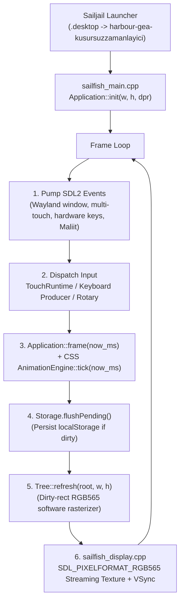

# How GeaStack Runs Natively on Sailfish OS

Sailfish OS applications are traditionally built with Qt 5 / QML and Silica. Running **Kum Saati** natively on Sailfish OS 5.1 without Qt or a WebView is made possible by two layers:

1. **The Sailfish OS runtime backend (`@geastack/linux` + `@geastack/engine` + `@geastack/core`):** Opens a fullscreen Wayland SDL2 window, renders through GeaStack's RGB565 dirty-rect canvas engine, wires multi-touch and Maliit on-screen keyboard input, and synthesizes audio via SDL2/PulseAudio.
2. **Native ARM64 cross-host compilation on Apple Silicon (`sailfishos-macos-developmentkit`):** Bypasses the x86/VirtualBox limitation of the official Sailfish SDK by compiling directly inside the official Sailfish OS 5.1.0.11 `aarch64` sysroot chroot with native ARM64 GCC 13.4.

---

## 1. On-Device Runtime Architecture

When Sailjail launches `/usr/bin/harbour-gea-kusursuzzamanlayici`, control enters the main loop in `@geastack/linux/targets/sailfish-os/main/sailfish_main.cpp`:



### 1.1 Display & Dirty-Rect Rendering (`sailfish_display.cpp`)

- **Fullscreen Wayland SDL2 Window:** Created with `SDL_WINDOW_FULLSCREEN_DESKTOP | SDL_WINDOW_RESIZABLE | SDL_WINDOW_ALLOW_HIGHDPI`.
- **In-Process RGB565 Framebuffer:** GeaStack's `Canvas` draws into a `uint16_t` (`RGB565`) pixel buffer sized to the drawable's physical pixels divided by integer scale.
- **Dirty-Region Upload & Clipping:** `Display::pushClip` / `popClip` and `Display::flushRects` upload only mutated regions into an `SDL_PIXELFORMAT_RGB565` streaming texture rather than redrawing the entire frame.
- **VSync Pacing:** Uses `SDL_RENDERER_ACCELERATED | SDL_RENDERER_PRESENTVSYNC` (falling back to `SDL_RENDERER_SOFTWARE` if needed). When VSync paced the frame, the main loop skips its own `nanosleep` to prevent double-pacing frame drops.

### 1.2 Pixel-Perfect High-DPI Scaling (DPR)

`sailfish_main.cpp` and `config.mjs` support two DPR strategies:

- **`"devicePixelRatio": "auto"` (recommended for ARM phones):** Picks the largest integer DPR that keeps the panel's short side at least `360` CSS pixels wide, so every CSS pixel maps cleanly to an exact `N × N` block of physical panel pixels:
  - **Jolla C2 (720×1600):** DPR `2` → `360×800` CSS viewport
  - **Xperia XA2 / 10 / 10 II–V / Jolla Phone (1080×1920..2520):** DPR `3` → `360×640..840` CSS viewport
  - Because DPR is derived from the panel rather than the current window size, opening the Maliit on-screen keyboard does not rescale the UI.
- **Explicit numeric DPR (this app sets `2`):** Overridable at runtime without rebuilding:

```sh
GEA_SAILFISH_DPR=auto harbour-gea-kusursuzzamanlayici
# or
GEA_SAILFISH_DPR=3 harbour-gea-kusursuzzamanlayici
```

Other runtime environment overrides:
- `GEA_SAILFISH_WIDTH`, `GEA_SAILFISH_HEIGHT`
- `GEA_SAILFISH_SCALE` (integer presentation scale, default `1`)
- `GEA_SAILFISH_HIGHDPI` (`0` disables `SDL_WINDOW_ALLOW_HIGHDPI`)
- `GEA_SAILFISH_STORAGE_DIR` (override for file-backed `localStorage`)

### 1.3 Multi-Touch & Input Handling (`sailfish-device-fixes`)

The `mehmetfiskindal/linux#sailfish-device-fixes` branch addresses several physical-device details:

- **No duplicate touch synthesis:** `SDL_SetHint(SDL_HINT_TOUCH_MOUSE_EVENTS, "0")` prevents SDL from synthesizing mouse clicks from finger touches. Real fingers (`SDL_FINGER*`) are tracked across up to 10 simultaneous pointer slots and queued directly into `TouchRuntime::queueTouchEvent`.
- **Single logical-space scaling:** Because `SDL_RenderSetLogicalSize` already normalizes finger and pointer coordinates to the logical viewport, `injectFinger()` scales only once (`nx * sailfish_canvas_width()`), preventing hits from landing at half coordinates.
- **Hardware & Maliit On-Screen Keyboard:** Hardware key/text events reuse the Raspberry Pi OS `rpios_keyboard.h` producer (UTF-8 insertion and whole-codepoint Backspace). On touch devices, `maliit-glib` automatically opens the Sailfish virtual keyboard when an `<input>` gains focus (with hidden text for `type="password"`) and closes it when focus leaves.

### 1.4 Audio Synthesis on Sailfish OS (`sailfish_audio.cpp`)

`Kum Saati` generates countdown ticks and end-of-cycle melodies through `__gea_audioContext.createOscillator()`.

Originally, `targets/sailfish-os/main/sailfish_audio.cpp` was a silent stub. To produce real sound on Sailfish OS while respecting the device's hardware volume keys:

- **SDL2 PulseAudio Driver:** Sailfish OS 5.1's `libSDL2-2.0.so.0` already ships with the `pulseaudio` driver compiled in, so no extra RPM dependency or `BuildRequires` is needed.
- **System Volume Integration (`PULSE_PROP_media.role=x-maemo`):** Before initializing `SDL_INIT_AUDIO` and calling `SDL_OpenAudioDevice`, `sailfish_audio.cpp` sets:
  ```cpp
  setenv("PULSE_PROP_media.role", "x-maemo", 0);
  setenv("PULSE_PROP_application.name", GEA_SAILFISH_APP_TITLE, 0);
  ```
  Setting `media.role=x-maemo` ensures Sailfish OS's PulseAudio policy routes playback through the normal system volume controls instead of playing at full unattenuated volume (while still allowing a caller to override the environment variable).
- **Lock-Free Realtime Synthesizer:** Mirrors `@geastack/apple`'s `apple_audio.mm` design:
  - Single-consumer lock-free command ring feeding up to 64 simultaneous voices on the SDL2 `AUDIO_F32SYS` stereo callback thread (zero allocations or mutex locks on the audio thread).
  - Supports `Sine`, `Square`, `Sawtooth`, and `Triangle` waveforms, `AudioContext::currentTime()`, sample-accurate `start(when)` / `stop(when)`, `setValue()` / `setValueAtTime()`, and smooth ~2.5 ms attack / ~6 ms release envelopes to prevent clicks on short notes.
  - Also supports `AudioSystem::volume()` / `setVolume()`, `playPcm()`, `playFile()` (WAV via `SDL_LoadWAV`), and `stopPlayback()`.
  - Runtime diagnostics: `GEA_AUDIO_DEBUG=1` logs the negotiated SDL audio driver, sample rate, buffer size, and `media.role`; `GEA_AUDIO_DISABLED=1` forces silent fallback.

### 1.5 Turkish & Extended Unicode Glyphs (`mehmetfiskindal/core`)

`Kum Saati`'s UI relies on Turkish text (`AKIŞ`, `ŞİMDİKİ DÖNGÜ`, `KALAN SÜRE`, `Döngüyü başlat`) and typographic symbols (`·`, `—`, `−`, `✳`).

In `@geastack/engine`, the lightweight `stb_truetype` runtime TTF rasterizer (`packages/engine/rasterized_font.cpp`) previously cached only printable ASCII (`0x20–0x7e`) plus a small set of symbols. The `mehmetfiskindal/core` fork (`main`, commit `77b9806`) extends `kRuntimeExtraCodepoints` with:

- **Turkish & circumflex Latin characters:** `Ğ/ğ` (`0x011e`/`0x011f`), `İ/ı` (`0x0130`/`0x0131`), `Ş/ş` (`0x015e`/`0x015f`), `Ç/ç` (`0x00c7`/`0x00e7`), `Ö/ö` (`0x00d6`/`0x00f6`), `Ü/ü` (`0x00dc`/`0x00fc`), `Â/â`, `Î/î`, `Û/û`
- **UI punctuation & symbols:** middle dot `·` (`0x00b7`), en/em dash `–`/`—`, minus sign `−` (`0x2212`), eight-spoked asterisk `✳` (`0x2733`), arrows (`←↑→↓`), and curly quotes

Combined with the embedded `Inter-Regular.ttf`, all Turkish copy and symbols rasterize crisply at any DPR.

### 1.6 Sailjail Sandbox & Harbour Packaging

`prepare.mjs` generates a Harbour-compliant `.desktop` file:

```ini
[Desktop Entry]
Type=Application
Name=Kum Saati
Exec=harbour-gea-kusursuzzamanlayici
Icon=harbour-gea-kusursuzzamanlayici
X-Nemo-Application-Type=generic

[X-Sailjail]
OrganizationName=org.geastack
ApplicationName=kusursuzzamanlayici
Permissions=Audio
```

- Only `Audio` is requested (exposing the PulseAudio socket to Sailjail); no `Internet` or filesystem permissions are granted.
- Every shared library dependency in the built RPM is a standard Sailfish OS system library: `libSDL2-2.0.so.0`, `libcurl.so.4`, `libmaliit-glib.so.2`, `libglib-2.0.so.0`, `libgobject-2.0.so.0`, `libc.so.6`, `libm.so.6`, `libstdc++.so.6`, `libgcc_s.so.1`.

### 1.7 How Native ARM64 Building Works on Apple Silicon

The official Sailfish SDK (`sfdk`) targets x86_64 hosts and VirtualBox does not support x86 guests on ARM Macs. Because Apple Silicon is natively ARM64, the build runs directly on ARM64 Linux with zero emulation:

```text
Apple Silicon Mac (macOS ARM64)
  └── Docker Desktop (native linux/arm64 VM — no QEMU)
        └── Ubuntu 22.04 ARM64 container (sailfish-arm64-probe:local)
              └── chroot /opt/sailfish (Docker volume: sailfish-5.1.0.11-aarch64-build)
                    ├── Official Sailfish OS 5.1.0.11 aarch64 SDK target sysroot
                    ├── Sailfish GCC / G++ 13.4.0, CMake 3.31.8, rpm-build 4.16.1
                    └── SDL2-devel, libcurl-devel, maliit-framework-wayland-devel
                          └── harbour-gea-kusursuzzamanlayici-0.1.0-1.aarch64.rpm
```

- The compiler, CMake, and `rpmbuild` execute inside `chroot /opt/sailfish`, so host Ubuntu libraries are completely isolated from the build and every linked `GLIBC`/`GLIBCXX`/`SDL2`/`maliit-glib` symbol matches Sailfish OS 5.1.0.11 `aarch64`.
- Storing the extracted sysroot in a Linux Docker volume preserves case sensitivity, POSIX permissions, and symlinks.
