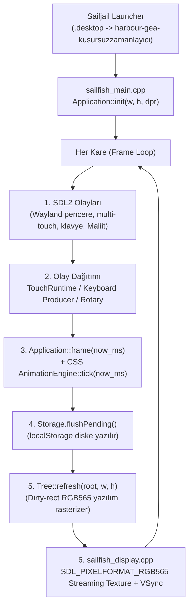

# Sailfish OS'ta GeaStack Nasıl Mümkün Oldu ve Nasıl Çalışır?

Sailfish OS normalde Qt 5 / QML ve Silica bileşen seti üzerine kuruludur. **Kum Saati** uygulamasının Qt veya WebView kullanmadan Sailfish OS 5.1 üzerinde native olarak çalışmasını mümkün kılan iki ana parça vardır:

1. **Uygulama çalışma zamanı (`@geastack/linux` + `@geastack/engine` + `@geastack/core`):** Wayland üzerinde SDL2 penceresi açıp GeaStack'in kendi RGB565 çizim motorunu, dokunmatik yönlendiricisini ve Maliit ekran klavyesini bağlar.
2. **Apple Silicon üzerinde yerel ARM64 derleme mimarisi (`sailfishos-macos-developmentkit`):** Resmi Sailfish SDK'nın x86/VirtualBox kısıtını aşarak macOS ARM64 üzerinde doğrudan Sailfish OS 5.1.0.11 `aarch64` sysroot chroot'unda native GCC 13.4 ile RPM üretir.

---

## 1. Çalışma Zamanı Mimarisi (Cihaz İçinde Neler Oluyor?)

Uygulama cihazda `/usr/bin/harbour-gea-kusursuzzamanlayici` olarak başlatıldığında kontrol `@geastack/linux/targets/sailfish-os/main/sailfish_main.cpp` içindeki ana döngüdedir:



### 1.1 Görüntüleme ve Çizim Hattı (`sailfish_display.cpp`)

- **Tam ekran Wayland + SDL2 penceresi:** `SDL_WINDOW_FULLSCREEN_DESKTOP | SDL_WINDOW_RESIZABLE | SDL_WINDOW_ALLOW_HIGHDPI` bayraklarıyla açılır.
- **RGB565 Bellek İçi Framebuffer:** GeaStack'in `Canvas` motoru doğrudan süreç içi bir `uint16_t` (`RGB565`) piksel tamponuna çizer.
- **Kirli Bölge (Dirty-Rect) ve Klip Yığını:** Her karede tüm ekranı baştan çizmek yerine, `Display::pushClip` / `popClip` ve `Display::flushRects` aracılığıyla yalnızca değişen bölgeler `SDL_PIXELFORMAT_RGB565` streaming dokusuna yüklenir.
- **VSync Zamanlaması:** `SDL_RENDERER_ACCELERATED | SDL_RENDERER_PRESENTVSYNC` ile donanım hızlandırmalı sunum açılır (olmazsa `SDL_RENDERER_SOFTWARE` yedek olarak devreye girer). VSync beklenmiş karelerde ana döngü ek `nanosleep` yapmayarak çift-bekleme (double-pacing) kaynaklı kare düşüşlerini önler.

### 1.2 Yüksek DPI (DPR) ve Piksel-Mükemmel Ölçekleme

`sailfish_main.cpp` ve `config.mjs` iki DPR modu sunar:

- **`"devicePixelRatio": "auto"` (ARM telefonlarda önerilen):** Panelin kısa kenarını en az `360` CSS pikseli tutacak en büyük tam sayı DPR'yi seçer:
  - **Jolla C2 (720×1600):** DPR `2` → `360×800` CSS viewport
  - **Xperia XA2 / 10 / 10 II–V / Jolla Phone (1080×1920..2520):** DPR `3` → `360×640..840` CSS viewport
  - Ekran klavyesi açılıp pencere küçüldüğünde DPR **değişmez**, çünkü hesaplama pencere yerine fiziksel panel boyutuna dayanır.
- **Sabit sayı (bu projede `2`):** `package.json` içinde `"devicePixelRatio": 2` tanımlıdır. Cihazda test ederken yeniden derlemeden çalışma zamanında ezilebilir:

```sh
GEA_SAILFISH_DPR=auto harbour-gea-kusursuzzamanlayici
# veya
GEA_SAILFISH_DPR=3 harbour-gea-kusursuzzamanlayici
```

Kullanılabilir diğer çalışma zamanı ortam değişkenleri:
- `GEA_SAILFISH_WIDTH`, `GEA_SAILFISH_HEIGHT`
- `GEA_SAILFISH_SCALE` (varsayılan `1`, tam sayı sunum büyütme)
- `GEA_SAILFISH_HIGHDPI` (`0` verilirse `SDL_WINDOW_ALLOW_HIGHDPI` kapanır)
- `GEA_SAILFISH_STORAGE_DIR` (`localStorage` dosyalarının yazılacağı dizin)

### 1.3 Çoklu Dokunmatik ve Giriş Düzeltmeleri (`sailfish-device-fixes`)

Bu projede `@geastack/linux` için `mehmetfiskindal/linux#sailfish-device-fixes` dalı kullanılmasının temel nedenleri:

- **Çift dokunma engeli:** `SDL_SetHint(SDL_HINT_TOUCH_MOUSE_EVENTS, "0")` ile SDL'nin dokunma olaylarından sahte fare olayı üretmesi kapatılır; parmaklar doğrudan `SDL_FINGER*` üzerinden 10 parmağa kadar kararlı `pointerId` ile `TouchRuntime::queueTouchEvent` kuyruğuna iletilir.
- **Doğru koordinat ölçekleme:** `SDL_RenderSetLogicalSize` olay izleyicisi koordinatları zaten mantıksal canvas uzayına normalize ettiği için, ikinci kez ölçekleme (dokunmaların yarı koordinata kayması) yapılmaz; `nx * sailfish_canvas_width()` yalnızca tek sefer uygulanır.
- **Klavye ve Maliit ekran klavyesi:** Donanım klavyesi Raspberry Pi OS ile ortak `rpios_keyboard.h` modülünü kullanır (`sailfish-device-fixes` ile paylaşılan başlık derleme dizinine kopyalanır). Ekran klavyesi ise `maliit-glib` üzerinden bir `<input>` odaklandığında otomatik açılıp odak gidince kapanır.

### 1.4 Türkçe Karakterler ve Özel Semboller (`mehmetfiskindal/core`)

`Kum Saati` arayüzünde Türkçe metinler (`AKIŞ`, `ŞİMDİKİ DÖNGÜ`, `KALAN SÜRE`, `SIFIRLA`, `Döngüyü başlat`) ve özel UI karakterleri (`·`, `—`, `−`, `✳`) yoğun şekilde kullanılır.

Upstream GeaStack'in FreeType olmayan (hafif `stb_truetype`) çalışma zamanı TTF rasterizer'ı yalnızca temel ASCII (`0x20–0x7e`) ve sınırlı birkaç sembolü önbelleğe alıyordu. `mehmetfiskindal/core` (`main`, commit `77b9806`) içindeki `packages/engine/rasterized_font.cpp` değişikliği ile `kRuntimeExtraCodepoints` tablosuna şu Unicode kod noktaları eklendi:

- **Türkçe ve şapkalı Latin harfleri:** `Ğ` (`0x011e`), `ğ` (`0x011f`), `İ` (`0x0130`), `ı` (`0x0131`), `Ş` (`0x015e`), `ş` (`0x015f`), `Ç/ç` (`0x00c7`/`0x00e7`), `Ö/ö` (`0x00d6`/`0x00f6`), `Ü/ü` (`0x00dc`/`0x00fc`), `Â/â`, `Î/î`, `Û/û`
- **UI sembolleri:** orta nokta `·` (`0x00b7`), en/em tire `–`/`—` (`0x2013`/`0x2014`), matematik eksi işareti `−` (`0x2212`), yıldız `✳` (`0x2733`), oklar (`←↑→↓`) ve tırnaklar

Böylece gömülü `Inter-Regular.ttf` fontu Sailfish OS cihazında her çözünürlük ve DPR'de eksiksiz Türkçe gliflerle rasterize edilir.

### 1.5 Sailjail Sandbox ve Harbour Paket Yapısı

`prepare.mjs` tarafından üretilen `.desktop` dosyası:

```ini
[Desktop Entry]
Type=Application
Name=Kum Saati
Exec=harbour-gea-kusursuzzamanlayici
Icon=harbour-gea-kusursuzzamanlayici
X-Nemo-Application-Type=generic

[X-Sailjail]
OrganizationName=org.geastack
ApplicationName=kusursuzzamanlayici
Permissions=Audio
```

- Uygulama `harbour-gea-*` adlandırmasıyla Harbour kurallarına uygun paketlenir.
- `Permissions=Audio` dışında ağ (`Internet`) veya dosya sistemi izni açılmaz (en az yetki ilkesi).
- Dinamik kütüphane bağımlılıkları yalnızca Sailfish OS'ta halihazırda bulunan sistem kütüphaneleridir: `libSDL2-2.0.so.0`, `libcurl.so.4`, `libmaliit-glib.so.2`, `libglib-2.0.so.0`, `libgobject-2.0.so.0`, `libc.so.6`, `libm.so.6`, `libstdc++.so.6`, `libgcc_s.so.1`.

### 1.6 Apple Silicon (macOS ARM64) Üzerinde Nasıl Mümkün Oldu?

Resmi Sailfish SDK (`sfdk`) x86_64 tabanlıdır ve Apple Silicon Mac'lerde VirtualBox x86 konukları desteklenmez. Ancak Apple Silicon **zaten ARM64** olduğu için tersine büyük bir avantaj ortaya çıkar:

```text
Apple Silicon Mac (macOS ARM64)
  └── Docker Desktop (native Linux ARM64 VM — QEMU yok!)
        └── Ubuntu 22.04 ARM64 container (sailfish-arm64-probe:local)
              └── chroot /opt/sailfish (Docker volume: sailfish-5.1.0.11-aarch64-build)
                    ├── Resmi Sailfish OS 5.1.0.11 aarch64 sysroot
                    ├── Sailfish GCC / G++ 13.4.0, CMake 3.31.8, rpm-build 4.16.1
                    └── SDL2-devel, libcurl-devel, maliit-framework-wayland-devel
                          └── harbour-gea-kusursuzzamanlayici-0.1.0-1.aarch64.rpm
```

- Derleyici (GCC 13.4), CMake ve `rpmbuild` **doğrudan Sailfish OS target sysroot'u içinde native ARM64 olarak** çalışır.
- Host (Ubuntu) kütüphaneleri chroot dışındadır; üretilen ikilinin `GLIBC`, `GLIBCXX`, `SDL2`, `libcurl` ve `maliit-glib` sembol sürümleri birebir Sailfish OS 5.1.0.11 `aarch64` ile eşleşir.
- Sysroot'un macOS dosya sistemi yerine Linux Docker volume'ünde (`sailfish-5.1.0.11-aarch64-build`) tutulması büyük/küçük harf duyarlılığını, POSIX izinlerini ve sembolik bağlantıları bozulmadan korur.

---

## 2. Bilinen Sınırlar ve Notlar

- **Ses çıkışı (Sailfish backend):** `@geastack/linux` içindeki `targets/sailfish-os/main/sailfish_audio.cpp` şu an için stub (sessiz) durumdadır (`AudioContext` / `OscillatorNode` çağrıları uygulamayı çökertmeden güvenli şekilde yutulur). Web ve iOS hedeflerinde sesli geri sayım çalışır; Sailfish OS'ta gerçek ses çıkışı için `sailfish_audio.cpp` içine SDL2 Audio / PulseAudio osilatör backend'i eklenmesi sonraki adımdır.
- **GitHub monorepo SHA sabitlemesi:** `npm` (`pacote`) monorepo alt dizinlerinde branch adını SHA'ya çevirirken `::path:` bilgisini düşürdüğü için `package.json` içinde `mehmetfiskindal/core` tam 40 karakterlik commit SHA ile sabitlenir. Detaylar için [Derleme ve Kurulum Rehberi](./sailfish-os-derleme-ve-kurulum.md) belgesine bakın.
